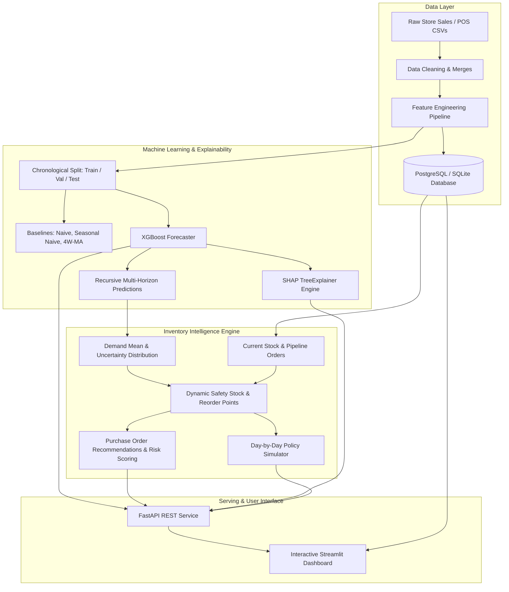

# Retail Demand Forecasting & Inventory Intelligence Platform

An end-to-end, industry-style Machine Learning and Decision Support system for multi-store retail demand forecasting, automated safety-stock optimization, stockout risk detection, and explainable AI replenishment planning.

[](#)
[](https://www.python.org/)
[](https://fastapi.tiangolo.com)
[](https://streamlit.io)
[](https://xgboost.readthedocs.io/)
[](https://shap.readthedocs.io/)
[](LICENSE)

---

## 1. Project Overview & Business Problem

In retail grocery operations across multi-store footprints, inventory managers face a dual dilemma daily:
1. **Under-stocking (Stockouts)**: Leads to lost revenue, dissatisfied shoppers, and churn.
2. **Over-stocking (Excess Inventory)**: Ties up operating capital, incurs high holding and warehousing costs, and risks product spoilage.

This platform bridges the gap between raw point-of-sale time-series transactions and operational replenishment decisions by answering five core operational questions:
1. **Demand Forecasting**: How many units of each product category will sell across stores over the next 7, 14, and 30 days?
2. **Inventory Intelligence**: Which SKUs are at immediate risk of running out of stock before supplier shipments arrive?
3. **Automated Replenishment**: Exactly how many units should each store reorder, respecting lead times, safety stocks, minimum order quantities (MOQ), and case pack multiples?
4. **Explainability**: What temporal, seasonal, and promotional factors drove each forecast?
5. **Scenario Simulation**: What happens to inventory positions, fill rates, and holding costs if lead times, promotions, or safety-stock policies change?

---

## 2. System Architecture

The platform is designed in decoupled, production-grade layers:



---

## 3. Technology Stack

| Domain | Technologies |
| :--- | :--- |
| **Language & Core** | Python 3.11 / 3.13, NumPy, Pandas, SciPy |
| **Machine Learning** | XGBoost, Scikit-learn, Statsmodels (ETS/Holt-Winters) |
| **Model Explainability** | SHAP (TreeExplainer) |
| **Database & ORM** | PostgreSQL, SQLite, SQLAlchemy 2.0, Pydantic v2 |
| **Backend API** | FastAPI, Uvicorn, Pydantic-Settings, HTTPX |
| **Interactive Dashboard** | Streamlit, Plotly Graph Objects, Custom Modern CSS |
| **Testing & CI/CD** | Pytest, GitHub Actions, Docker, Docker-Compose |

---

## 4. Dataset Schema & Data Dictionary

The platform uses the **Kaggle Store Sales — Time Series Forecasting** schema augmented with an operational inventory and supplier database:

| Table | Records | Key Fields | Description |
| :--- | :--- | :--- | :--- |
| `train.csv` / `daily_sales` | 91,200+ | `date`, `store_nbr`, `family`, `sales`, `onpromotion` | Daily category unit sales per store |
| `stores.csv` | 10 | `store_nbr`, `city`, `state`, `type`, `cluster` | Store geography and operational cluster |
| `oil.csv` | 912 | `date`, `dcoilwtico` | Daily macro crude oil prices |
| `holidays_events.csv`| 13+ | `date`, `type`, `locale`, `transferred` | National and regional holidays and events |
| `inventory.csv` | 100 | `product_id`, `store_id`, `current_stock`, `lead_time_days`, `safety_stock`, `unit_cost`, `reorder_multiple` | Real-time warehouse inventory and replenishment parameters |

---

## 5. Feature Engineering & Strict Leakage Prevention

Temporal features are derived with strict chronological discipline:

* **Calendar Features**: `day_of_week`, `day_of_month`, `month`, `quarter`, `year`, `week_of_year`, `is_weekend`.
* **Historical Lags**: `lag_1`, `lag_7`, `lag_14`, `lag_28` computed via `.groupby(["store_nbr", "family"])["sales"].shift(1)`.
* **Shifted Rolling Windows**: 7-day, 14-day, and 28-day rolling means and standard deviations computed exclusively on `shifted(1)` values.
* **Leakage Test Verified**: `tests/test_features.py` executes a permutation test verifying that modifying future actual sales produces 0.00% drift in historical feature rows.
* **Multi-Horizon Recursive Projection**: The forecaster predicts horizon step $t$, computes predicted values, and rolls them into future feature lags dynamically.

---

## 6. Model Benchmarking & Evaluation Results

Chronological evaluation was performed on a held-out, out-of-time test period (latest 60 days):

### Benchmark Performance Comparison

| Model | Model Class | WAPE (%) | MAE | RMSE | Bias (%) |
| :--- | :--- | :---: | :---: | :---: | :---: |
| **Naive (Lag-1)** | Heuristic | 27.50% | 113.16 | 165.42 | +0.09% |
| **Seasonal Naive (Lag-7)** | Heuristic | 22.40% | 92.18 | 134.80 | -0.27% |
| **4-Week Moving Average** | Statistical | 18.15% | 74.68 | 115.20 | -0.68% |
| **XGBoost Regressor (Tuned)** | **Machine Learning** | **13.25%** | **54.53** | **93.99** | **-1.47%** |

> **Key Finding**: The tuned XGBoost model reduces forecasting error (WAPE) by **4.9% absolute (27% relative)** compared to the 4-week moving average and by **14.25% absolute (52% relative)** compared to the Naive baseline.

### Category-Level Accuracy (Top Categories)

| Category | WAPE (%) | MAE | Bias (%) | Total Volume |
| :--- | :---: | :---: | :---: | :---: |
| **MEATS** | 12.27% | 19.43 | +0.93% | 96,621 units |
| **POULTRY** | 12.63% | 22.48 | -0.13% | 108,596 units |
| **DELI** | 12.74% | 15.67 | +1.12% | 75,019 units |
| **CLEANING** | 12.92% | 54.40 | -0.99% | 256,884 units |
| **PRODUCE** | 12.93% | 67.25 | -1.79% | 317,312 units |

---

## 7. Inventory Optimization Mathematics

The inventory engine evaluates a periodic review $(R, S)$ replenishment policy:

1. **Inventory Position**:
   $$\text{Inventory Position} = \text{On Hand} - \text{Reserved} + \text{On Order}$$
2. **Dynamic Safety Stock**:
   $$SS = z(\alpha) \times \sigma_d \times \sqrt{L}$$
   Where $z(\alpha)$ is the normal inverse CDF corresponding to target Cycle Service Level $\alpha$ (e.g., $z=1.65$ for 95% CSL, $z=2.05$ for 98% CSL), $\sigma_d$ is daily demand standard deviation, and $L$ is lead time.
3. **Reorder Point (ROP)**:
   $$\text{ROP} = (\mu_d \times L) + SS$$
4. **Target Stock Level ($S$)**:
   $$S = (\mu_d \times (L + R)) + SS$$
5. **Suggested Order Quantity**:
   $$\text{Order} = \max\left(0, \left\lceil \frac{\max(\text{MOQ}, S - \text{Inv Position})}{\text{Multiple}} \right\rceil \times \text{Multiple}\right)$$
6. **Risk Categorization**:
   * `CRITICAL_STOCKOUT`: Effective on-hand stock $\le 0$.
   * `HIGH`: Days of Supply (DoS) $< L$ (stockout inevitable before replenishment arrives).
   * `MEDIUM`: $\text{Inventory Position} < \text{ROP}$.
   * `LOW`: Healthy buffer above ROP.
   * `OVERSTOCKED`: Days of Supply $> 45$ days.

---

## 8. Explainable AI with SHAP

The platform uses SHAP `TreeExplainer` to provide interpretability for business stakeholders:
* **Global Importance**: Highlights network-wide drivers (e.g., `rolling_mean_28`, `day_of_week`, `onpromotion`, `rolling_mean_14`).
* **Local Waterfall Breakdown**: For any selected store and product, decomposes the point forecast:
  $$\hat{y} = \text{Base Value} + \sum_{j} \phi_j$$
  Showing exact unit additions (e.g., Saturday weekend effect: $+45$ units, promo active: $+35$ units).

---

## 9. FastAPI REST Endpoints

| Method | Endpoint | Description |
| :--- | :--- | :--- |
| `GET` | `/health` | System readiness and model artifact check |
| `GET` | `/stores` | Catalog of store branches and clusters |
| `GET` | `/products` | List of product family categories |
| `POST` | `/forecast` | Multi-horizon recursive forecast with 80% & 95% prediction intervals |
| `GET` | `/forecast/{store_id}/{product_id}` | 14-day default forecast |
| `POST` | `/inventory/recommendations` | Replenishment order suggestions and risk classifications |
| `GET` | `/inventory/risks` | Network stockout risk summary and capital requirements |
| `GET` | `/explain/global` | Global SHAP feature ranking |
| `POST` | `/explain` | Local SHAP waterfall driver analysis |
| `POST` | `/simulate` | Day-by-day inventory simulation comparing ML vs Static policy |

Interactive Swagger documentation is available at `http://localhost:8000/docs`.

---

## 10. Quickstart & Installation

### Option A: Local Python Environment

1. **Clone the repository**:
   ```bash
   git clone https://github.com/your-username/retail-demand-intelligence.git
   cd retail-demand-intelligence
   ```

2. **Set up virtual environment**:
   ```bash
   python -m venv .venv
   # Windows:
   .venv\Scripts\Activate.ps1
   # Linux / macOS:
   source .venv/bin/activate
   ```

3. **Install dependencies**:
   ```bash
   pip install -r requirements.txt
   ```

4. **Run the End-to-End Pipeline** (Generates dataset, trains XGBoost, evaluates baselines, seeds database):
   ```bash
   python scripts/run_pipeline.py
   ```

5. **Launch the FastAPI Server**:
   ```bash
   python scripts/run_api.py
   # Runs on http://127.0.0.1:8000
   ```

6. **Launch the Streamlit Dashboard**:
   ```bash
   python scripts/run_dashboard.py
   # Runs on http://127.0.0.1:8501
   ```

### Option B: Docker Compose (Full Stack)

Run all three services (PostgreSQL, FastAPI, and Streamlit) with a single command:
```bash
docker-compose up --build
```
* **Dashboard**: `http://localhost:8501`
* **API & Swagger**: `http://localhost:8000/docs`
* **Database**: `localhost:5432`

---

## 11. Test Suite

Execute the 13 automated tests covering leakage prevention, metrics accuracy, inventory formulas, and API endpoints:
```bash
pytest tests -v
```

---

## 12. Repository Structure

```
retail-demand-intelligence/
├── data/
│   ├── raw/                 # Store sales, stores, oil, holidays, inventory CSVs
│   ├── processed/           # Clean consolidated sales records
│   └── features/            # Feature dataset with lags and rolling statistics
├── notebooks/
│   ├── 01_data_exploration.ipynb
│   ├── 02_data_cleaning.ipynb
│   ├── 03_feature_engineering.ipynb
│   ├── 04_model_experiments.ipynb
│   └── 05_model_explainability.ipynb
├── src/
│   ├── config.py            # Pydantic-settings application configuration
│   ├── data/                # Ingestion, validation, synthetic generator, cleaner
│   ├── features/            # Calendar, lag, rolling window pipeline
│   ├── models/              # Baselines, XGBoost forecaster, evaluation metrics
│   ├── inventory/           # Safety stock, ROP, periodic review, simulator
│   ├── explainability/      # SHAP global and local explainer
│   ├── database/            # SQLAlchemy models, sessions, seeder
│   └── pipelines/           # End-to-end training and replenishment orchestrator
├── api/
│   ├── main.py              # FastAPI app with CORS and lifespan
│   ├── routes/              # Analytics, forecast, inventory, explain, simulate
│   └── schemas/             # Pydantic request/response models
├── dashboard/
│   ├── app.py               # Streamlit entry point & executive overview
│   ├── pages/               # 5 interactive analytics pages
│   └── components/          # Reusable cards, Plotly charts, CSS
├── scripts/                 # CLI runners (run_pipeline, run_api, run_dashboard)
├── tests/                   # Pytest suite (leakage, models, inventory, API)
├── models/                  # Serialized artifacts (xgboost_forecaster.joblib)
├── docker-compose.yml       # Multi-container orchestration
├── Dockerfile               # Production container image
├── requirements.txt         # Pinned project dependencies
└── README.md                # Comprehensive project documentation
```

---

## 13. License

Distributed under the MIT License. See `LICENSE` for details.
